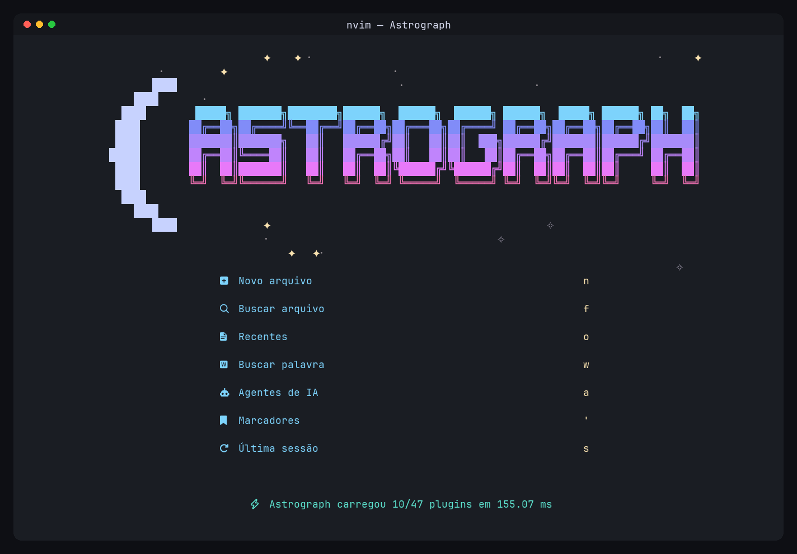

# Astrograph

**Um Neovim pronto para usar**, baseado no [AstroNvim](https://github.com/AstroNvim/AstroNvim),
com **agentes de IA dentro do editor**, abertura mais rápida e tudo em **português**.

📖 **Documentação:** <https://just-gabe.github.io/Astrograph/>



## Instalar

**Windows** (PowerShell):

```powershell
irm https://raw.githubusercontent.com/Just-Gabe/Astrograph/main/install.ps1 | iex
```

**Linux / macOS** (bash):

```bash
curl -fsSL https://raw.githubusercontent.com/Just-Gabe/Astrograph/main/install.sh | bash
```

O instalador cuida de tudo: Neovim 0.11+, Git, ripgrep, fd, compilador C, a
JetBrainsMono Nerd Font, o clone do Astrograph e a ligação da config (com backup da
antiga). No fim, um checklist opcional instala agentes de IA: Claude Code, opencode,
Codex, Gemini e Ollama. Depois é só abrir um terminal novo e rodar `nvim`.

[Mais detalhes da instalação →](https://just-gabe.github.io/Astrograph/instalacao)

## O que vem pronto

- **Agentes de IA no prefixo `<Leader>A`**: terminal flutuante com Claude Code,
  opencode, Codex ou Gemini; chat do CodeCompanion; edição inline com o avante; IA
  local com Ollama. Ele detecta sozinho o que está instalado.
- **Em português**: menu de atalhos, tela inicial, `:checkhealth astrograph` e
  mensagens.
- **Mais rápido**: abre em ~280 ms no Windows (o AstroNvim original, ~390 ms) e o
  primeiro arquivo em ~120 ms (antes, ~230 ms).
- **Tema próprio**: `astrograph` (escuro) e `astrograph-light`, com contraste
  verificado.
- **Arquivos editados pelo agente recarregam sozinhos** no editor.
- **`:Astrograph`**: `atualizar`, `saude`, `agentes`, `atalhos`, `docs`.

| Editor | Menu de atalhos (`Espaço`) |
| --- | --- |
|  |  |
| **Agentes de IA (`Espaço` `A`)** | **Diagnóstico (`:Astrograph saude`)** |
|  |  |

## Primeiros passos

| Atalho | O que faz |
| --- | --- |
| `Espaço` | Mostra todos os atalhos (espere meio segundo) |
| `<Leader>ff` / `<Leader>fw` | Buscar arquivo / texto |
| `<Leader>e` | Explorador de arquivos |
| `<Leader>w` / `<Leader>q` | Salvar / fechar janela |
| `<Leader>Al` | Abrir um agente de IA no terminal |
| `<Leader>Ac` | Chat com IA |
| `<Leader>AE` | Pedir uma edição para a IA (selecione o trecho antes) |
| `<Leader>um` | Ligar/desligar as animações |

`<Leader>` é a tecla **Espaço**. Veja a [lista completa](https://just-gabe.github.io/Astrograph/uso)
e o [guia dos agentes](https://just-gabe.github.io/Astrograph/agentes).

## Estrutura

```
core/       fork do core do AstroNvim (v6.1.0) com as otimizações
template/   a config que o Neovim abre
theme/      colorschemes astrograph e astrograph-light
tools/      geradores da arte da tela inicial e dos prints
docs/       documentação (GitHub Pages) e prints
```

[Como funciona por dentro →](https://just-gabe.github.io/Astrograph/desenvolvimento) ·
[Performance →](https://just-gabe.github.io/Astrograph/performance) ·
[Solução de problemas →](https://just-gabe.github.io/Astrograph/problemas)

## Créditos e licença

Baseado no [AstroNvim](https://github.com/AstroNvim/AstroNvim) (GPL-3.0), de Micah
Halter ([mehalter](https://github.com/mehalter)) e colaboradores; usa o lazy.nvim e o
snacks.nvim de Folke Lemaitre. Mantido por [Just-Gabe](https://github.com/Just-Gabe).
O `core/` mantém a licença original; veja o [`LICENSE`](./LICENSE).
