# Astrograph

**Um editor pronto para usar**, baseado no [AstroNvim](https://github.com/AstroNvim/AstroNvim),
com **agentes de IA dentro do editor**, abertura mais rápida e tudo em **português**.
O app em Rust é o principal; o Neovim com a config do Astrograph segue como espelho
para quem prefere o terminal.

📖 **Documentação:** <https://just-gabe.github.io/Astrograph/>

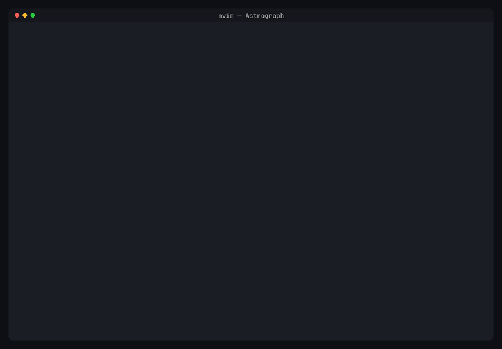

## Instalar

**Windows** (PowerShell):

```powershell
irm https://raw.githubusercontent.com/Just-Gabe/Astrograph/main/install.ps1 | iex
```

**Linux / macOS** (bash):

```bash
curl -fsSL https://raw.githubusercontent.com/Just-Gabe/Astrograph/main/install.sh | bash
```

O instalador cuida de tudo: Neovim 0.11+, Git, ripgrep, fd, compilador C, a
JetBrainsMono Nerd Font, o clone do Astrograph, o app em Rust (baixado do release ou
compilado, instalando Rust e linker se faltarem) e a ligação da config. Se já houver
uma config do Neovim, ele pergunta se limpa e substitui, importa seus plugins ou
mantém. No fim, um checklist opcional instala agentes de IA: Claude Code, opencode,
Codex, Gemini e Ollama. Em seguida ele instala o que o chat precisa e oferece
fazer o **login de cada agente** ali mesmo. Depois é só abrir um terminal novo e
rodar `nvim`.

[Mais detalhes da instalação →](https://just-gabe.github.io/Astrograph/instalacao)

## O que vem pronto

- **Agentes de IA no prefixo `<Leader>A`**: Claude Code, opencode, Codex ou Gemini
  no terminal flutuante e no chat, usando o login de cada CLI (sem chave de API);
  edição inline com o avante; IA local com Ollama. `:Astrograph configurar`
  instala e faz login no que faltar.
- **Em português**: menu de atalhos, tela inicial, `:checkhealth astrograph` e
  mensagens.
- **Mais rápido**: abre em ~256 ms no Windows (o AstroNvim original, ~392 ms);
  arquivos abrem em estágios, com o essencial em ~59 ms.
- **Visual no estilo Apple**: tema grafite inspirado no Xcode (cores calmas, um
  destaque só), tela inicial limpa e barra de status discreta; linha de comando
  com destaque, cursor animado, bordas arredondadas e ghost text.
- **Ações com o agente**: corrigir o erro da linha (`<Leader>Ax`), explicar
  (`<Leader>Ai`), revisar suas alterações (`<Leader>Ar`) e escrever a mensagem
  de commit (`<Leader>Am`). O editor avisa antes se o agente estiver sem login.
- **Resposta imediata**: o que você usa é pré-carregado quando o editor está
  ocioso, e o código aparece sem ruído (sem CodeLens nem `~` por padrão).
- **Movimento**: janelas com fade, explorador deslizante e `dd` animado (a
  linha colapsa e some), sempre sem atrasar a edição.
- **Um agente para tudo**: escolha com `<Leader>Ag` e terminal, chat e edição
  inline passam a usar o mesmo agente; a escolha fica salva. O modo (Manual,
  Aceitar edições, Plano, Auto) também: `<Leader>Aw` vale para todas as telas.
- **Código próprio onde importa**: cores e TODOs desenhados pelo motor nativo
  do Neovim, no lugar de dois plugins; rolar a tela ficou ~10× mais leve.
- **Tema próprio**: `astrograph` (escuro) e `astrograph-light`, com contraste
  verificado.
- **Arquivos editados pelo agente recarregam sozinhos** no editor.
- **Sessões de todos os projetos** (`<Leader>AS`): as conversas do agente com a
  tag do modelo que as fez; retomar volta para a pasta e o agente da conversa.
- **Plugins só desta máquina**: specs do lazy em
  `%LOCALAPPDATA%\astrograph-local\specs` (ou `$ASTROGRAPH_LOCAL`), fora do git.
  São código Lua executado na abertura do editor: ponha ali só o que é seu.
- **Gerenciador de arquivos TUI**: com yazi, lf, nnn, ranger ou vifm instalado,
  `<Leader>fm` (arquivo atual), `<Leader>fM` (raiz do projeto) e `<Leader>fv`
  (divisão vertical) abrem o gerenciador; na árvore, `T` abre a pasta sob o cursor
  (via [tfm.nvim](https://github.com/Rolv-Apneseth/tfm.nvim)).
- **`:Astrograph`**: `atualizar`, `saude`, `agentes`, `configurar`, `login`, `sessoes`, `atalhos`, `docs`.

| Editor | Menu de atalhos (`Espaço`) |
| --- | --- |
| 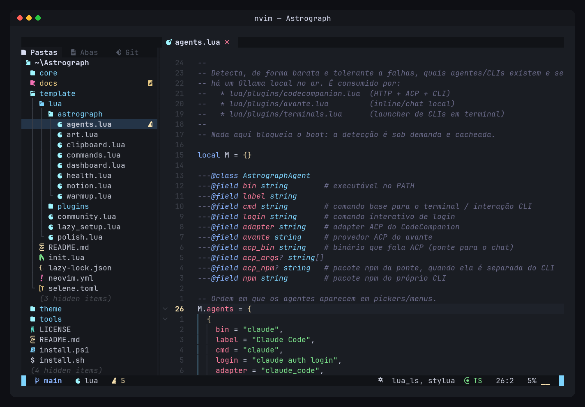 | 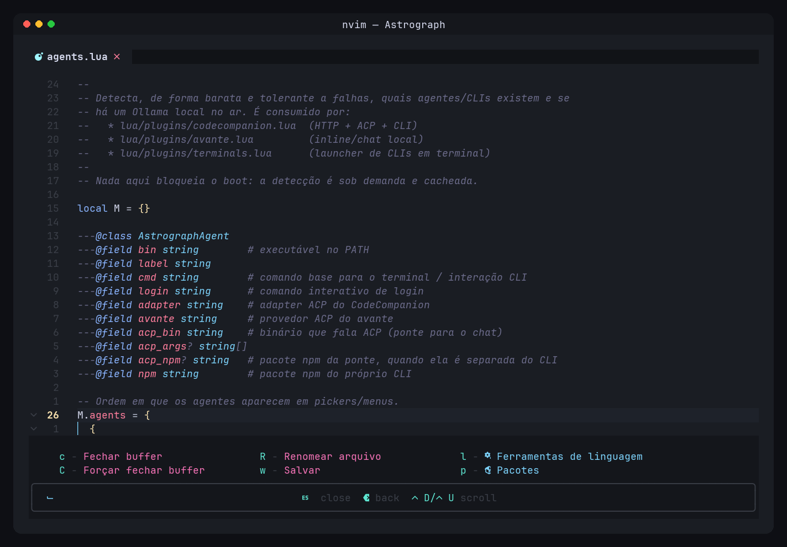 |
| **Agentes de IA (`Espaço` `A`)** | **Chat com o Claude Code (`Espaço` `A` `c`)** |
| 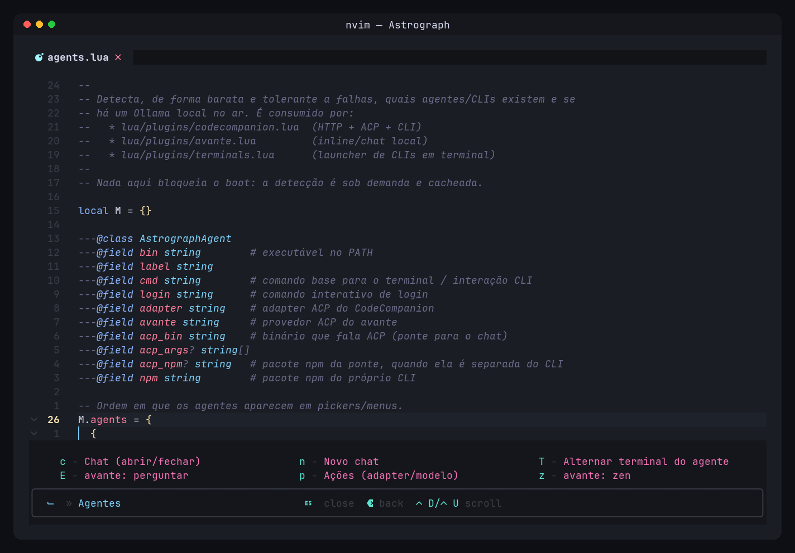 | 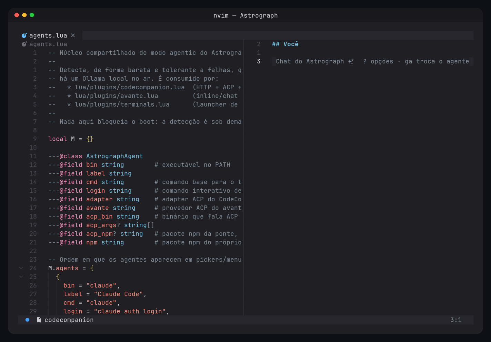 |
| **Completação com ghost text** | **Diagnóstico (`:Astrograph saude`)** |
| 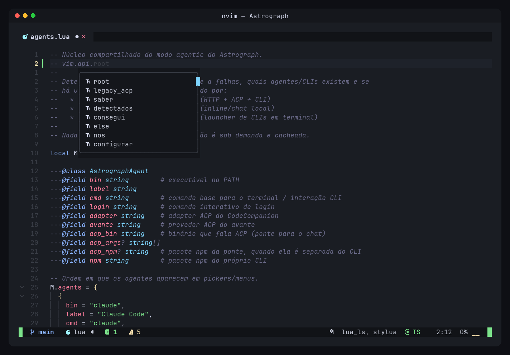 | 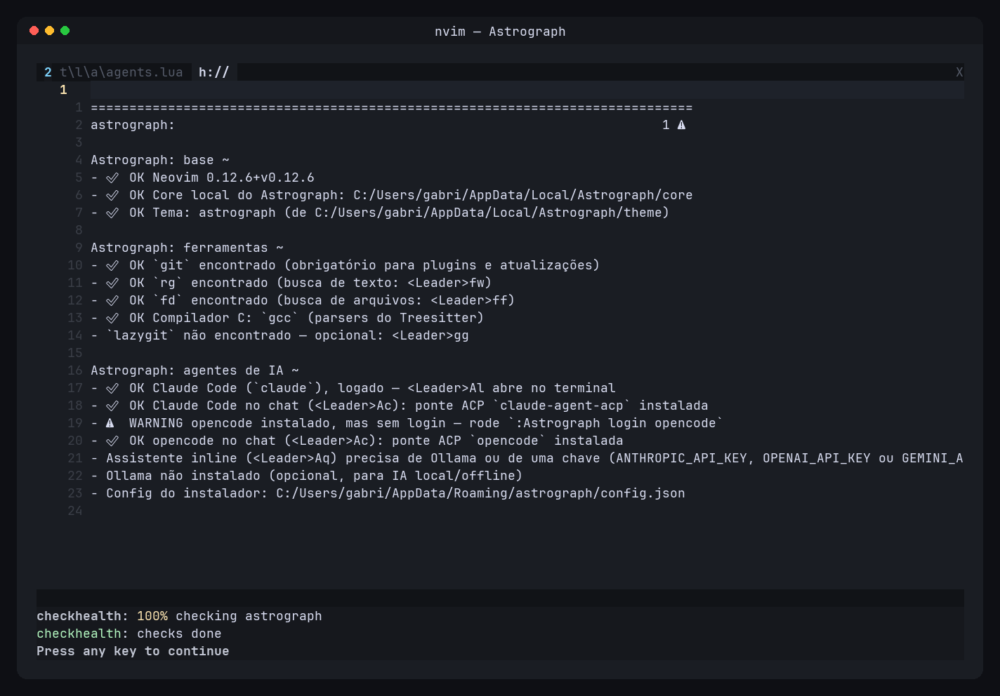 |
| **Explorador deslizando (`<Leader>e`)** | **`dd`: a linha colapsa e some** |
| 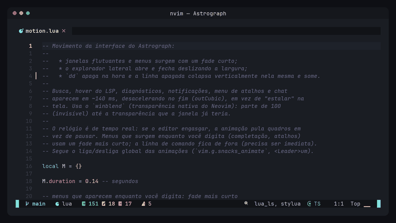 | 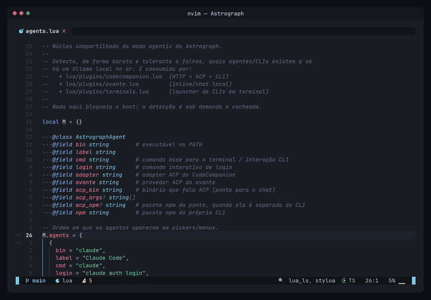 |

### O app em Rust (motor nativo)

O app ([`prototype/astrograph-ui`](prototype/astrograph-ui)) abre com um **motor próprio em
Rust, sem Neovim**: mais rápido, sem travas e sem nada para configurar. Ele reproduz os atalhos do Vim e é
testado contra o Neovim de verdade (milhares de sequências de teclas comparadas com o `nvim --headless`).
O Neovim com a config do Astrograph continua como espelho para quem prefere o terminal:
`ASTROGRAPH_ENGINE=nvim astrograph` (ou `[engine] native = false` no `config.toml` da UI) abre o app com ele.

- **Vim completo**: movimentos, operadores, objetos de texto (inclusive de tree-sitter: `if af ic ac ia aa`), visual
  (caractere, linha e bloco), registradores, macros, marcas, jumplist e changelist, `.`, desfazer, busca, `:s :g :normal :sort :t :m`,
  `gq`, `gf`, `gx`, folds (`za`, `zM`, `foldmethod=indent|syntax`), mapeamentos (`:map`, `[keys]` no `config.toml`) e `:set`.
- **Navegação**: buscador próprio com trecho do arquivo (`<Espaço>ff` arquivos, `fw` texto, `fo` recentes; sem `fd`/`ripgrep`),
  explorador que cria, renomeia, copia, move e apaga arquivos e marca o estado do git (`<Espaço>e`), abas e janelas
  divididas, menu de atalhos ao esperar depois da líder (configurável: `[keys] leader`).
- **Linguagens**: LSP nativo (rust-analyzer, pyright, typescript, gopls, lua, clangd, bash, json, yaml, toml...: diagnósticos,
  hover `K`, `gd`, completar com snippets e imports automáticos, renomear, ações de código, formatar, referências, símbolos),
  realce e recuo por tree-sitter, `.editorconfig`, git na margem e o branch na pílula.
- **IA**: terminal nativo (`<Espaço>t`; vários com `<Espaço>N`), agentes (Claude Code, opencode, Codex, Gemini e Ollama local)
  em `<Espaço>Al`, edição da seleção ou pergunta pelo `<Espaço>AE`, citar arquivo ou linhas em `<Espaço>Ac`, modo zen em
  `<Espaço>Az`, `:AgentInstall` e `:AgentLogin`.
- **Aparência**: cena de pixels no estilo Apple (fonte Inter na interface, cantos arredondados, sombras) com animações em mola,
  **tema claro** (`[theme] mode = "dark" | "light" | "auto"`, `:set background=light`), a mesma tela inicial do Neovim,
  relógio no canto (`[clock] enabled = false` desliga) e indicador do que roda em segundo plano.
- **`:Astrograph`**: `atualizar` (transacional, com desfazer automático), `saude`, `agentes`, `modo`, `configurar`, `login`,
  `sessoes`, `atalhos` e `docs`, como no Neovim.

Ainda faltam: quebra de linha (`wrap`) e validação do app no Windows e no macOS; a lista completa está em
[`docs/motor-nativo.md`](docs/motor-nativo.md).

Um quadro completo custa ~2 ms em 1280×800 (CPU); sem animação, o app não repinta.

| Editor | Busca com trecho do arquivo |
| --- | --- |
| 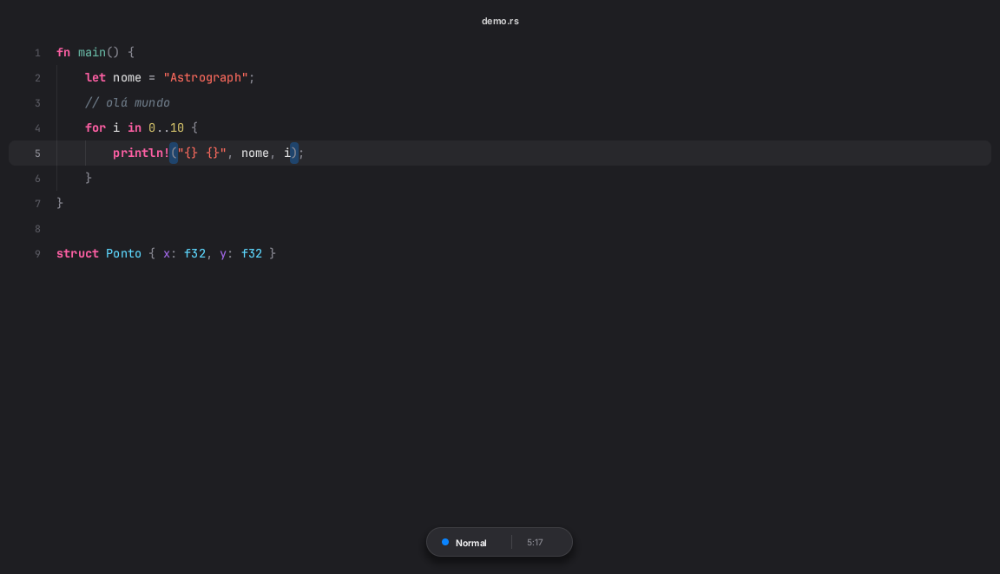 | 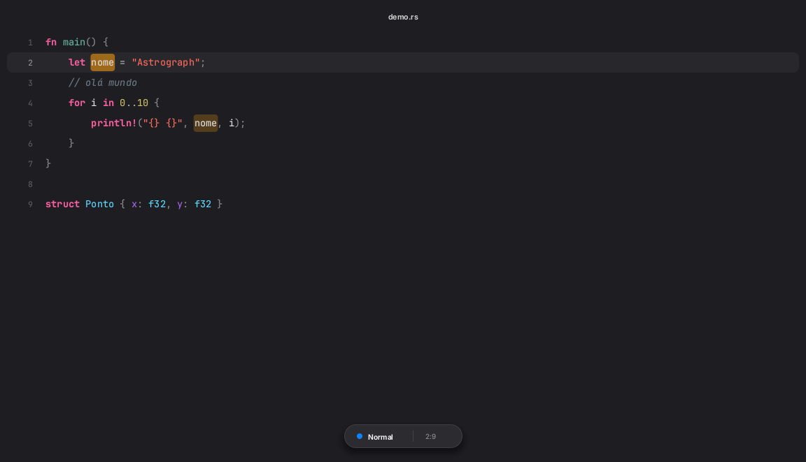 |
| **Menu de atalhos (`Espaço` `A`)** | **Tema claro (`:set background=light`)** |
| 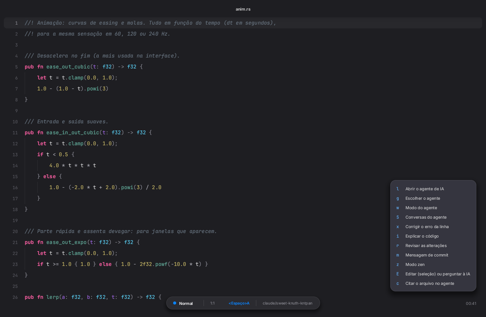 | 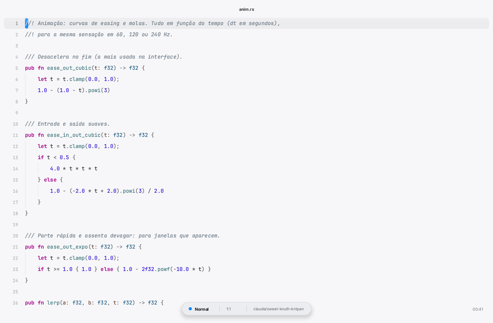 |

No app com Neovim, o texto desliza por pixel ao rolar, o cursor desliza e pisca com
fade, e as janelas flutuantes ganham sombra:

| Abertura | Rolagem por pixel |
| --- | --- |
| 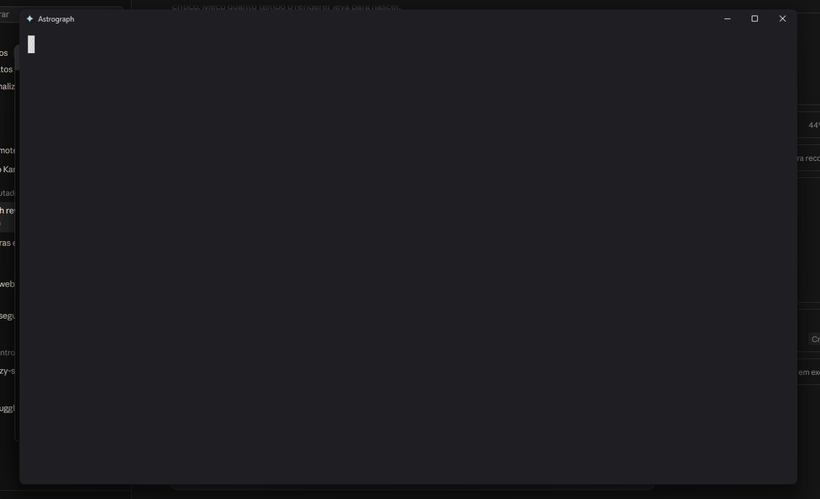 | 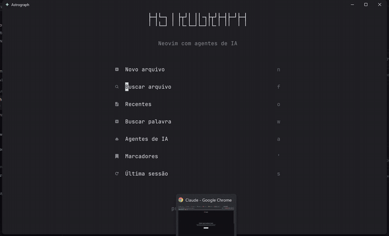 |
| **Cursor: desliza, muda de forma e pisca com fade** | **Busca com sombra** |
| 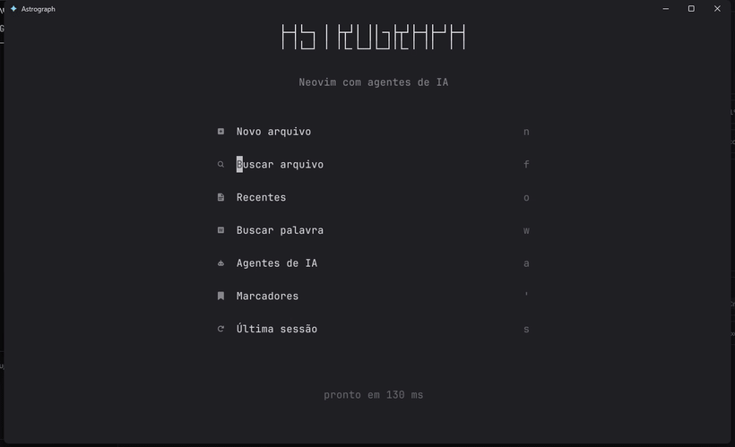 | 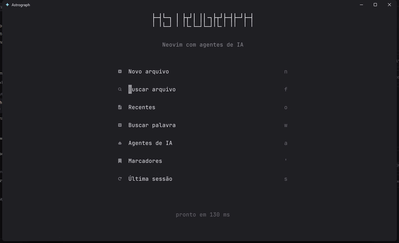 |

Em segundo plano o app prepara o projeto (git, parsers, ferramentas) com um
indicador discreto no canto; `:Astrograph atualizar` é transacional, com backup e
rollback automático. Detalhes em [`docs/motor-nativo.md`](docs/motor-nativo.md).

## Primeiros passos

| Atalho | O que faz |
| --- | --- |
| `Espaço` | Mostra todos os atalhos (espere meio segundo) |
| `<Leader>ff` / `<Leader>fw` | Buscar arquivo / texto |
| `<Leader>e` | Explorador de arquivos |
| `<Leader>w` / `<Leader>q` | Salvar / fechar janela |
| `<Leader>Al` | Abrir um agente de IA no terminal |
| `<Leader>Ac` | Chat com IA |
| `<Leader>AE` | Pedir uma edição para a IA (selecione o trecho antes) |
| `<Leader>Ax` / `<Leader>Ar` | Corrigir o erro da linha / revisar suas alterações |
| `<Leader>AS` | Sessões do agente de todos os projetos (retomar) |
| `<Leader>um` | Ligar/desligar as animações |

`<Leader>` é a tecla **Espaço**. Veja a [lista completa](https://just-gabe.github.io/Astrograph/uso)
e o [guia dos agentes](https://just-gabe.github.io/Astrograph/agentes).

## Estrutura

```
core/       fork do core do AstroNvim (v6.1.0) com as otimizações
template/   a config que o Neovim abre
theme/      colorschemes astrograph e astrograph-light
tools/      geradores da arte da tela inicial e dos prints
prototype/  o app em Rust: astrograph-ui (janela), astrograph-core (motor modal),
            astrograph-syntax (tree-sitter), astrograph-servicos (preparo e
            atualização), astrograph-agent
docs/       documentação (GitHub Pages) e prints
```

[Como funciona por dentro →](https://just-gabe.github.io/Astrograph/desenvolvimento) ·
[Performance →](https://just-gabe.github.io/Astrograph/performance) ·
[Astrograph e AstroNvim →](https://just-gabe.github.io/Astrograph/astronvim) ·
[Solução de problemas →](https://just-gabe.github.io/Astrograph/problemas)

## Créditos e licença

Baseado no [AstroNvim](https://github.com/AstroNvim/AstroNvim) (GPL-3.0), de Micah
Halter ([mehalter](https://github.com/mehalter)) e colaboradores; usa o lazy.nvim e o
snacks.nvim de Folke Lemaitre. Mantido por [Just-Gabe](https://github.com/Just-Gabe).
O `core/` mantém a licença original; veja o [`LICENSE`](./LICENSE).
