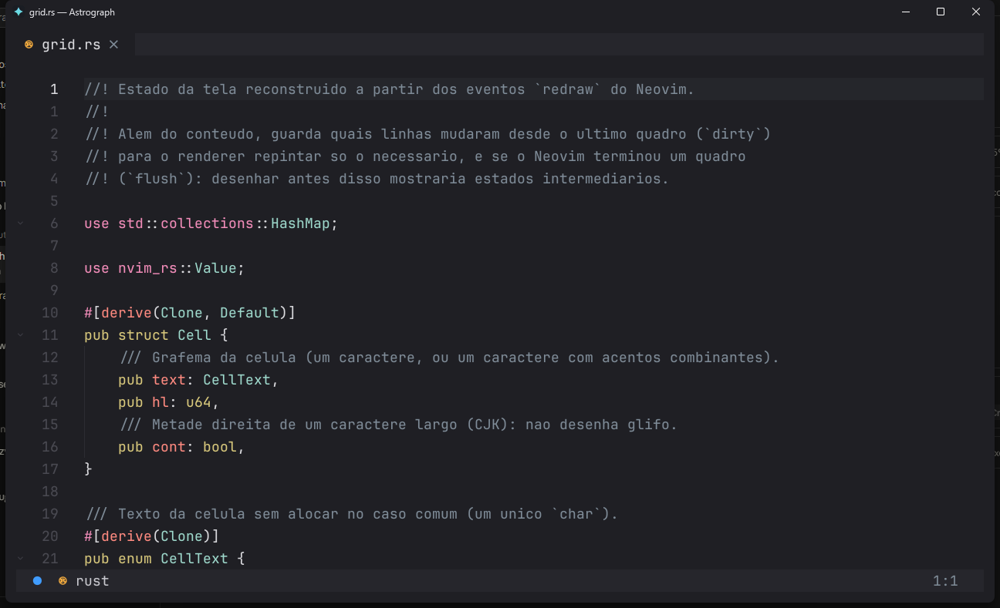

# astrograph-ui (spike)

Spike de viabilidade da **UI em Rust** do Astrograph sobre um **Neovim embutido**
(`nvim --embed`, protocolo UI via msgpack-rpc). Rota R1: o Neovim continua sendo
o motor; o Rust assume a casca. O objetivo de medio prazo e **desacoplar do
AstroNvim**, nao do Neovim.

Ver o epico #1 e as issues do spike (#3..#8).


| Rolagem por pixel | Cursor (desliza, muda de forma, pisca com fade) |
|-------------------|--------------------------------------------------|
|  |  |
| **Busca com sombra** | **Editor** |
|  |  |

## Rodar

```
cargo run
```

Variaveis uteis para verificacao automatizada:

```
SPIKE_SMOKE=1 cargo run   # dump da grade em texto e sai
SPIKE_INPUT=1 cargo run   # testa input (digita ":" e checa cmdline)
SPIKE_WIDE=1 cargo run    # caracteres largos (CJK): espera "AB你好CD"
SPIKE_KEYS=1 cargo run    # teclas especiais: <, \, | chegam literais
SPIKE_CLIP=1 cargo run    # copia com "+y e cola com "+p (tipo de registro preservado)
SPIKE_SCROLL=1 cargo run  # rolagem por pixel: conta os quadros intermediarios do Ctrl+D/Ctrl+U
SPIKE_FLOATS=1 cargo run  # janela flutuante com borda chega a UI (para a sombra)
SPIKE_BENCH=1 cargo run --release   # ms/quadro: tela inteira e so o que mudou
cargo test --release      # testes de unidade (grade, publicacao, cores, ligaduras)
cargo test --release -- --ignored --nocapture bench_ligaduras   # pior caso das ligaduras
DEBUG_FONT=1 cargo run    # imprime metricas da fonte
```

## Configuracao

Config TOML opcional (ver `astrograph-ui.example.toml`). Ordem de busca: flag
`--config`, `ASTROGRAPH_UI_CONFIG`, `./astrograph-ui.toml`, ao lado do exe,
`%APPDATA%\astrograph\ui.toml`. Ajusta janela, fonte (tamanho em px de EM,
altura de linha, arquivos por estilo), margem, cursor (piscar e deslize) e
rolagem (`[scroll] animation_ms`).

## Atalhos (UI)

- `Ctrl +` / `Ctrl -`: aumenta/diminui a fonte.
- `Ctrl 0`: volta ao tamanho da config.
- `F11`: tela cheia.

O restante do teclado e do mouse vai para o Neovim (mouse via `nvim_input_mouse`).
Fechar a janela pede `:confirm qa` ao Neovim: arquivos nao salvos perguntam antes.

## Etapas

- Passo 0: gate de toolchain (winit + softbuffer abrem janela). OK
- Passo 1: prova de protocolo (embed + ui_attach + parse de redraw). OK
- Passo 2: modelo de estado da tela (grid + highlights). OK
- Passo 3: render CPU com softbuffer + atlas de glifos. OK
- Passo 4: input de teclado + cursor. OK
- Passo 5: medicao + FINDINGS.md + go/no-go. OK (ver `FINDINGS.md`)

Resultado: **GO** para a rota R1 (UI em Rust sobre Neovim embutido).

## Fase 1 (produto) - em andamento

- Config TOML (janela, fonte, cursor, margem).
- Fonte configuravel (tamanho em EM, altura de linha, arquivos por estilo).
- Atalhos de UI: zoom (`Ctrl +/-/0`), tela cheia (`F11`).
- Identidade: icone proprio; titulo "arquivo — pasta" como no macOS.
- Cursor por modo (bloco/barra/sublinhado), deslizando entre posicoes (80 ms,
  ease-out); a troca de forma e animada (o bloco afina ate virar barra); pisca
  com fade (como no macOS) e so depois de uma pausa; contorno quando a janela
  perde o foco.
- Rolagem suave por pixel: o texto desliza e desacelera em vez de pular de
  linha em linha; rolagens seguidas se somam (segurar `j` fica continuo).
- Sombra suave sob janelas flutuantes com borda (busca, hover, chat), que
  acompanha o fade de abertura delas.
- Abre ja no tamanho certo (o Neovim conecta com o tamanho real da janela) e
  aparece em ~175 ms, na cor do tema, com o conteudo entrando em fade.
- Caracteres largos (CJK) e grafemas com acentos combinantes.
- Mouse: clique, arrasto (selecao visual), roda e touchpad (rolagem por pixel
  acumulada), com modificadores.
- Teclado completo: `<lt>`, Ctrl/Alt/Shift com teclas especiais, F1–F12, AltGr.
- Area de transferencia do sistema sem processos externos (`arboard`), com o
  tipo de registro (linha inteira vs. trecho) preservado na colagem.
- Sublinhado, ondulado (undercurl) e riscado, na cor `special`.
- Blocos (`▀▄█░▒▓`, quadrantes) e toda a familia de molduras finas e grossas
  (`─━│┃┌┏┣╋…`, cantos arredondados `╭╮╯╰`) desenhados como geometria: sem
  frestas em nenhuma fonte ou zoom.
- Altura de linha 1.2 por padrao: texto com respiro.
- Visual: barra de titulo e borda na cor do tema, cantos arredondados (Windows
  11), margem ao redor do texto, janela que cabe na tela e abre ja pintada.
- Fallback de fontes por glifo (emoji, simbolos, CJK), configuravel.
- Ligaduras de programacao (`->`, `=>`, `!=`, `===`, `<=`, `|>`) com
  `rustybuzz`, desligaveis em `font.ligatures`; o trecho sob o cursor volta
  aos caracteres da celula.
- Decisao: `wgpu` **nao** e necessario (render por CPU; ver `FINDINGS.md`).
- Pendente: `ext_multigrid`, IME. Fallback
  CJK completo depende de fonte TTF (os fontes CJK do Windows sao TTC, que o
  ab_glyph nao carrega).

## Integracao com a config

A UI avisa a config que e ela quem desenha (`g:astrograph_gui`, definido antes
de qualquer plugin). Com isso a config:

- desliga o scroll linha a linha do Snacks e o smear-cursor (a UI anima nativo);
- roda as animacoes em Lua a 120 fps (no terminal, 60);
- avisa a UI de cada rolagem de janela (`WinScrolled`) e das janelas flutuantes
  com borda (para a sombra).
